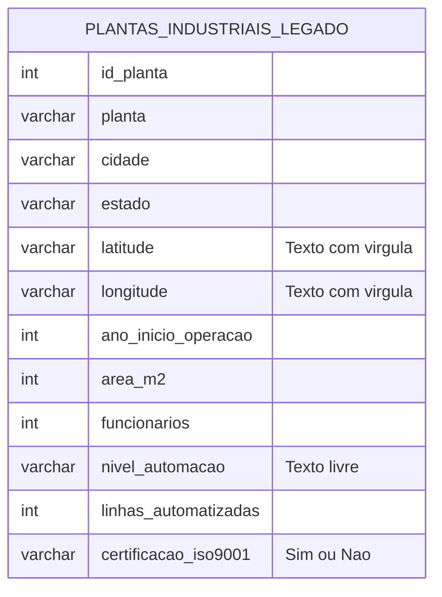
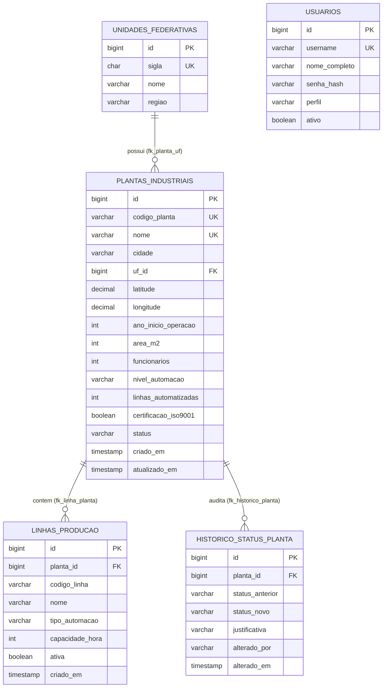
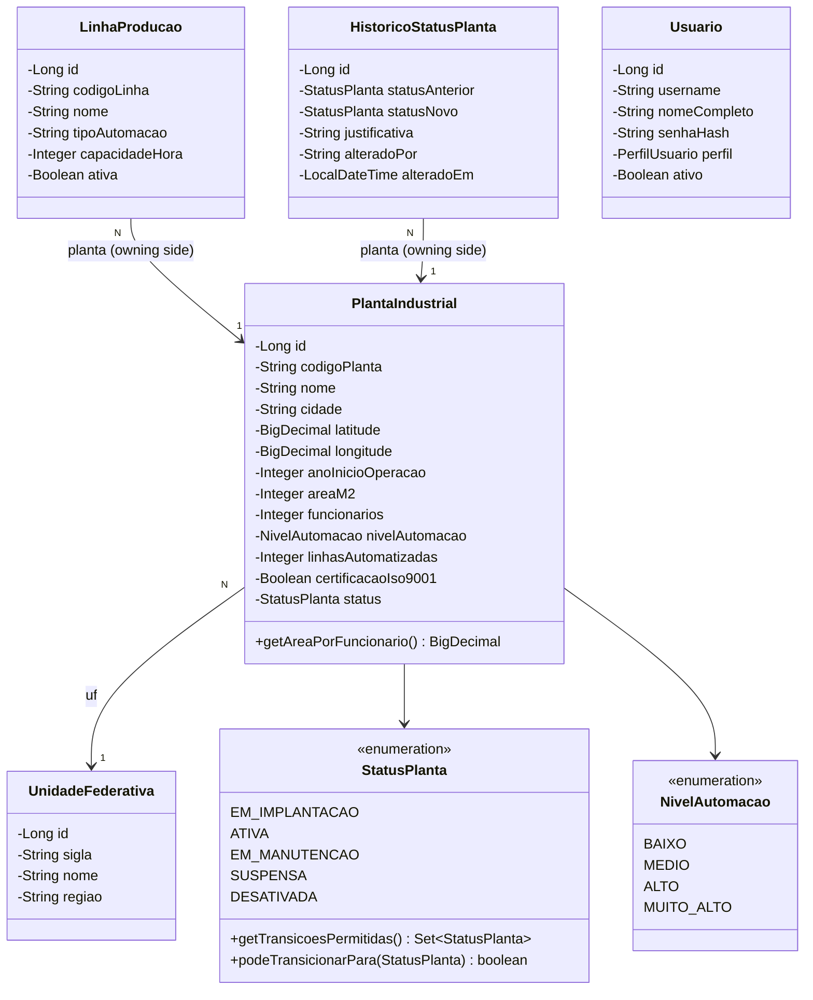

# Relatório Técnico — Modernização do Sistema de Gestão de Plantas Industriais

**Curso:** Engenharia de Computação — ESEG (Escola Superior de Engenharia e Gestão)  
**Disciplina:** Programação Web — Projeto Integrador Full Stack (2º semestre de 2026)  
**Base Legada Analisada:** `Plantas_Industriais.csv` (10 registros, 12 atributos)

---

## 1. Diagnóstico Crítico da Base Legada

A base original era armazenada em formato tabular plano (`Plantas_Industriais.csv`), sem separação de entidades, sem controle transacional e sem restrições de integridade. O inventário detalhado identificou os seguintes problemas críticos:

| # | Campo / Aspecto Legado | Situação Encontrada | Problema / Risco Técnico | Solução Adotada na Evolução |
|---|---|---|---|---|
| 1 | `id_planta` e `planta` | Inteiro sequencial 1–10 e texto solto | Ausência de chave de negócio padronizada e de restrição `UNIQUE` no nome da unidade (risco de duplicação) | Criação de `codigo_planta` (`UNIQUE`, padrão `PLT-UF-NNN`) + `UNIQUE` em `nome` |
| 2 | `latitude` e `longitude` | Texto com vírgula decimal (`"-23,69"`, `"-46,56"`) | Impossibilita cálculos geoespaciais/ordenação numérica e aceita strings arbitrárias | Conversão para `DECIMAL(9,6)` (`BigDecimal`) com validação de faixa `[-90, 90]` e `[-180, 180]` |
| 3 | `estado` | Sigla textual repetida (`SP` em 4 registros) | Texto livre sujeito a erros de digitação e ausência de atributo `regiao` para análises | Normalização em tabela `unidades_federativas` (3FN) com FK `uf_id` e índice `idx_planta_uf` |
| 4 | `certificacao_iso9001` | Texto `"Sim"` (7) / `"Não"` (3) | Booleano em string vulnerável a acentuação/maiúsculas (`"sim"`, `"Nao"`) | Conversão para tipo nativo `BOOLEAN NOT NULL` |
| 5 | `nivel_automacao` | `"Médio"`, `"Alto"`, `"Muito alto"` | Domínio aberto e capitalização inconsistente (`"Muito alto"`) | Enumeração controlada `NivelAutomacao` (`BAIXO`, `MEDIO`, `ALTO`, `MUITO_ALTO`) com `CHECK` e índice |
| 6 | `area_m2`, `funcionarios`, `linhas_automatizadas`, `ano_inicio_operacao` | Inteiros sem restrições | Sem proteção contra valores negativos, área zero ou anos futuros absurdos | Validação em duas camadas: Bean Validation no DTO e `CHECK` no banco |
| 7 | Ciclo de vida / Status | **Inexistente** | Impossível diferenciar planta ativa, em manutenção, suspensa ou desativada | Enum `StatusPlanta` com máquina de estados, bloqueio de transições inválidas e tabela `historico_status_planta` |
| 8 | Detalhamento de linhas | Apenas contador agregado (`linhas_automatizadas`) | Sem rastreabilidade das linhas produtivas individuais de cada planta | Nova entidade `LinhaProducao` (`@ManyToOne` -> `PlantaIndustrial`) com trava de integridade na desativação |
| 9 | Segurança e Governança | **Inexistente** | Qualquer usuário podia alterar ou apagar registros sem autenticação ou auditoria | Spring Security com BCrypt, 2 perfis (`ADMIN` e `OPERADOR`), proteção CSRF e auditoria de transições |

---

## 2. Matriz de Rastreabilidade (Legado → Evolução → Evidência)

| ID | Requisito Original | Problema / Lacuna | Requisito Revisado / Novo | Justificativa | Implementação | Teste / Evidência |
|---|---|---|---|---|---|---|
| **RF-01** | Armazenar dados básicos de plantas em planilha | Sem CRUD web, sem validação e sem unicidade | **CRUD completo de `PlantaIndustrial`** com validação de domínio e unicidade de código/nome | Garantir integridade cadastral e persistência relacional | `PlantaIndustrialController`, `PlantaIndustrialService`, `PlantaFormDTO`, `plantas/form.html` | `PlantaIndustrialServiceTest#deveImpedirCadastroCodigoDuplicado`, `SecurityAndWebIntegrationTest#deveValidarCoordenadasForaDoIntervalo` |
| **RF-02** | Registrar UF como texto na coluna `estado` | Redundância e impossibilidade de agregação regional confiável | **Normalização de UFs (`unidades_federativas`)** com 27 UFs e regiões | Eliminar anomalias de atualização e habilitar KPIs por região | `UnidadeFederativa`, FK `uf_id` em `PlantaIndustrial`, `DataInitializer` | Carga validada em `SecurityAndWebIntegrationTest#deveCarregarDezPlantasLegadas` |
| **RF-03** | *(Novo)* Controle de situação operacional | Planilha não distingue unidades ativas, paradas ou encerradas | **Máquina de estados (`StatusPlanta`) + Auditoria (`HistoricoStatusPlanta`)** | Prevenir transições inconsistentes (ex.: reativar planta `DESATIVADA`) e registrar quem/por que alterou | `StatusPlanta.podeTransicionarPara()`, `PlantaIndustrialService.alterarStatus()`, `auditoria/lista.html` | `StatusPlantaTest` (4 cenários), `PlantaIndustrialServiceTest#deveAlterarStatusValidoERegistrarHistorico`, `#deveBloquearTransicaoStatusInvalida` |
| **RF-04** | Contador simples `linhas_automatizadas` | Sem gestão individual de linhas de produção | **Entidade `LinhaProducao` (1:N com `PlantaIndustrial`)** + bloqueio de desativação com linhas ativas | Demonstrar associação JPA real e regra de integridade entre entidades | `LinhaProducao` (lado proprietário `@JoinColumn`), `LinhaProducaoService`, `plantas/detalhes.html` | `PlantaIndustrialServiceTest#deveBloquearDesativacaoComLinhasAtivas` |
| **RF-05** | *(Novo)* Consulta segmentada e indicadores | Planilha exige filtros manuais locais | **Busca com filtros combinados no servidor (`JpaSpecificationExecutor`) + Dashboard KPI** | Facilitar tomada de decisão sobre ISO 9001, automação e distribuição regional | `PlantaIndustrialService.listarComFiltros()`, `calcularKPIs()`, `dashboard.html`, `plantas/lista.html` | `SecurityAndWebIntegrationTest#operadorPodeAcessarConsulta` |
| **RNF-01** | *(Novo)* Controle de acesso | Arquivo sem controle de permissão | **Autenticação + Autorização RBAC (`ADMIN` vs `OPERADOR`) no servidor** | Impedir escalonamento de privilégio via manipulação de URL/POST | `SecurityConfig`, `@PreAuthorize`, `CustomUserDetailsService`, `BCryptPasswordEncoder` | `SecurityAndWebIntegrationTest#usuarioAnonimoDeveIrParaLogin`, `#operadorDeveReceber403EmOperacoesAdmin`, `#adminPodeAcessarRotasAdministrativas` |

---

## 3. Modelagem Relacional (Legado vs. Evoluído)

### 3.1 Modelo Relacional Legado (Estrutura Plana Original)

### 3.2 Modelo Relacional Evoluído (Normalizado — 3FN)

---

## 4. Diagrama de Classes da Solução

---

## 5. Inventário de Decisões Técnicas (ADRs)

1. **Chave primária substituta (`Long id`) + chave natural única (`codigo_planta`)**
   - *Alternativa considerada:* usar `codigo_planta` como PK composta ou natural.
   - *Decisão e impacto:* `BIGINT` auto-incremento evita cascata de atualizações em FKs caso um código seja revisado, enquanto `uk_planta_codigo` e `uk_planta_nome` garantem unicidade no domínio.
2. **Máquina de estados encapsulada no enum `StatusPlanta`**
   - *Alternativa considerada:* condicionais `if/else` espalhadas em controllers ou templates.
   - *Decisão e impacto:* centralizar `podeTransicionarPara()` no próprio enum torna a regra testável isoladamente (`StatusPlantaTest`) e impede estados inconsistentes mesmo por requisições POST forjadas.
3. **Uso de `BigDecimal` com precisão `(9,6)` para coordenadas geográficas**
   - *Alternativa considerada:* `Double`/`Float`.
   - *Decisão e impacto:* evita imprecisão de ponto flutuante binário e garante padronização exata na migração das strings com vírgula da base legada.
4. **H2 em modo arquivo (`./data/plantasdb`) com driver PostgreSQL incluído**
   - *Alternativa considerada:* exigir servidor PostgreSQL/MySQL externo para avaliação.
   - *Decisão e impacto:* assegura 100% de reprodutibilidade imediata em qualquer máquina avaliadora com persistência real em disco, mantendo compatibilidade SQL para migração trivial para PostgreSQL.
5. **Autorização em duas camadas (`SecurityFilterChain` + `@PreAuthorize`)**
   - *Alternativa considerada:* apenas ocultar botões com `sec:authorize` no Thymeleaf.
   - *Decisão e impacto:* ocultar elementos é apenas UX; a proteção real acontece no servidor retornando `403 Forbidden` a qualquer tentativa direta via URL/HTTP.

---

## 6. Testes Automatizados, Cobertura e Limitações

### 6.1 Suítes Implementadas (`mvn test`)
- **`StatusPlantaTest` (Unitário):** valida todas as transições válidas, bloqueio de autotransições, bloqueio de regressão `ATIVA -> EM_IMPLANTACAO` e garantia de que `DESATIVADA` é estado terminal.
- **`PlantaIndustrialServiceTest` (Unitário com Mockito):** valida bloqueio de código duplicado, transição válida gerando registro em `HistoricoStatusPlanta`, lançamento de `TransicaoStatusInvalidaException`, bloqueio de desativação quando há linhas ativas, e bloqueio/permissão de exclusão conforme status `DESATIVADA`.
- **`SecurityAndWebIntegrationTest` (Integração com `MockMvc` + Spring Security):** verifica migração dos 10 registros legados, redirecionamento de anônimo para `/login`, acesso permitido para `OPERADOR` em `/dashboard` e `/plantas`, resposta `403 Forbidden` para `OPERADOR` em `/plantas/nova`, `/auditoria`, `/status` e `/excluir`, acesso permitido para `ADMIN` e validação de coordenadas fora do intervalo `[-90, 90]`.

### 6.2 Funcionalidades não cobertas por testes automatizados
- Testes de interface ponta a ponta em navegador real (Selenium/Playwright) para layout responsivo Bootstrap.
- Testes de estresse/concorrência em banco externo PostgreSQL.

### 6.3 Limitações Conhecidas e Melhorias Futuras
- A carga inicial (`DataInitializer`) atende ao ambiente acadêmico; em produção recomenda-se adotar **Flyway** ou **Liquibase** para versionamento formal de migrações DDL.
- Adicionar mapa interativo (Leaflet/OpenStreetMap) consumindo as coordenadas `latitude`/`longitude` normalizadas.
- Implementar gestão de usuários via interface administrativa e exportação de relatórios em CSV/PDF.

---

## 7. Guia Rápido para a Defesa Técnica Individual

1. **Justifique um identificador e uma restrição:** `id` (`BIGINT`) é a chave primária substituta estável; `codigo_planta` (`uk_planta_codigo`) é a chave natural de negócio padronizada (`PLT-UF-NNN`) que impede duplicidade sem acoplar FKs a strings mutáveis. A restrição `CHECK` + `@DecimalMin/@DecimalMax` em `latitude`/`longitude` elimina o defeito legado de strings com vírgula.
2. **Como o sistema bloqueia um status inválido?** Em duas camadas: na interface o select exibe apenas `planta.status.transicoesPermitidas`, mas a trava real está no servidor em `PlantaIndustrialService.alterarStatus()`, que chama `statusAtual.podeTransicionarPara(novoStatus)` e lança `TransicaoStatusInvalidaException` (além de checar se existem linhas de produção ativas antes de permitir `DESATIVADA`).
3. **Qual é o lado proprietário da associação JPA?** Em `PlantaIndustrial` ↔ `LinhaProducao`, o **lado proprietário** é `LinhaProducao`, pois contém o `@ManyToOne` e o `@JoinColumn(name = "planta_id")` (quem detém a chave estrangeira no banco). `PlantaIndustrial` é o lado inverso usando `mappedBy = "planta"`.
4. **Compare permissões entre os dois perfis:** `OPERADOR` consulta Dashboard, filtra Plantas, visualiza detalhes e gerencia linhas de produção (adicionar/alternar ativa). `ADMIN` possui tudo isso mais criar/editar/excluir plantas, executar transições de status auditadas e acessar `/auditoria`. Se `OPERADOR` tentar `/plantas/nova` ou `POST /plantas/1/status` diretamente, o Spring Security barra no servidor com **HTTP 403**.
5. **Explique o fluxo Controller → Model → Thymeleaf:** Ex.: `GET /plantas` cai em `PlantaIndustrialController.listar()`, que consulta `plantaService.listarComFiltros(...)`, insere a lista e filtros no objeto `Model` (`model.addAttribute("plantas", ...)`), retorna o nome lógico `"plantas/lista"`, e o Thymeleaf renderiza o HTML no servidor iterando com `th:each="p : ${plantas}"`.
6. **Antes x Depois de um requisito novo:** Antes, no CSV, não havia controle de ciclo de vida nem validação de estado (qualquer linha podia ser apagada sem rastro). Agora, uma planta só pode ser excluída se primeiro inativar suas linhas de produção, transicionar com justificativa obrigatória para `DESATIVADA` (registrando autor e timestamp em `historico_status_planta`) e então excluir como `ADMIN`.
